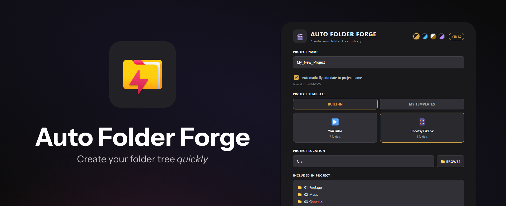
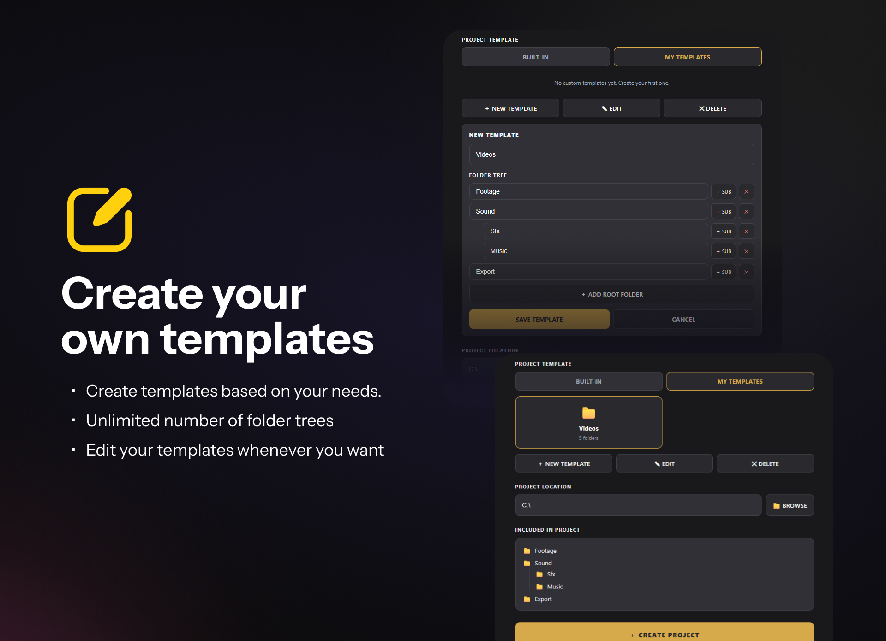
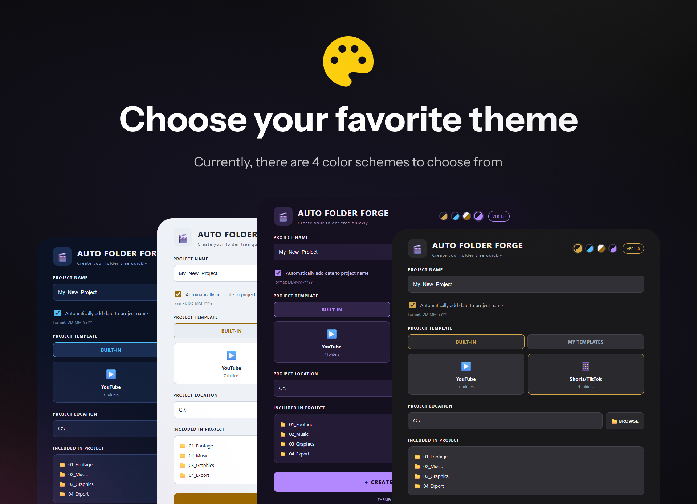

  

    
  

  <h1 align="left">AutoFolderForge</h1> 

## [Download the latest version](https://github.com/deenholden/Auto-Folder-Forge/releases)

> [!IMPORTANT]
> At this time, the program does not have a digital certificate, so Windows may flag it as malware when it runs.

AutoFolderForge is a free open-source tool that helps you optimize your workflow

  

    
  

### Create your own templates

  

    
  

### Choose a theme you like

  

    
  

## Requirements
[Microsoft Edge WebView2 Runtime](https://developer.microsoft.com/en-us/microsoft-edge/webview2?form=MA13LH&cs=4205858286)
